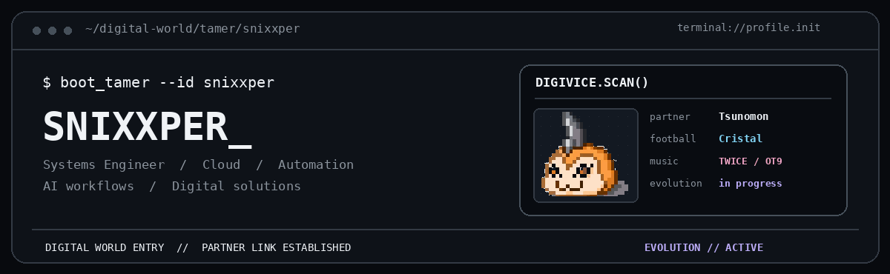
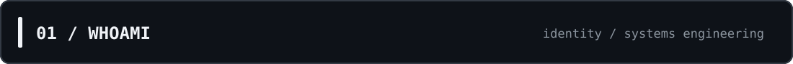
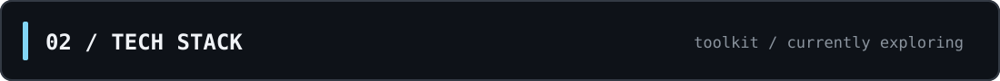
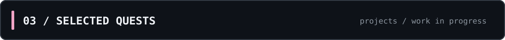
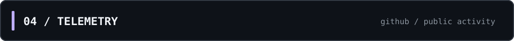

<div align="center">



<sub>systems engineering · cloud · automation · creative coding</sub>

</div>

<br />



```typescript
const snixxper = {
  role: "Systems Engineer",
  focus: ["Cloud", "Automation", "Digital Solutions"],
  exploring: ["AI Workflows", "APIs", "Creative Coding"],
  digitalPartner: "Tsunomon",
  footballClub: "Sporting Cristal",
  music: "TWICE",
  status: "always evolving"
} as const;
```

Soy ingeniera de sistemas y me gusta transformar ideas en soluciones útiles o eso creo 👾 Aquí conviven proyectos técnicos, experimentos creativos



**Enfoque actual:** `Omni` · `Cloud` · `APIs` · `Automation` · `AI workflows` · `Digital platforms`

```text
$ evolution --check
[FOUNDATION]  systems thinking
[BUILDING]    tools & digital solutions
[EXPLORING]   omni + cloud integrations + AI
[NEXT STAGE]  keep learning, keep shipping
```



| Mission | Description |
| :-- | :-- |
| 🛠️ [presalesgen](https://github.com/snixxper/presalesgen) | Herramientas y automatización para flujos de preventa. |
| 🧩 [pokedex](https://github.com/snixxper/pokedex) | Proyecto personal de experimentación. |
| 🎮 [pokesnixx](https://github.com/snixxper/pokesnixx) | Un rincón para proyectos geek y creativos. |



<div align="center">


<sub><code>STATUS: ONLINE</code> · <code>PARTNER: TSUNOMON</code> · <code>EVOLUTION: IN PROGRESS</code></sub>

</div>
